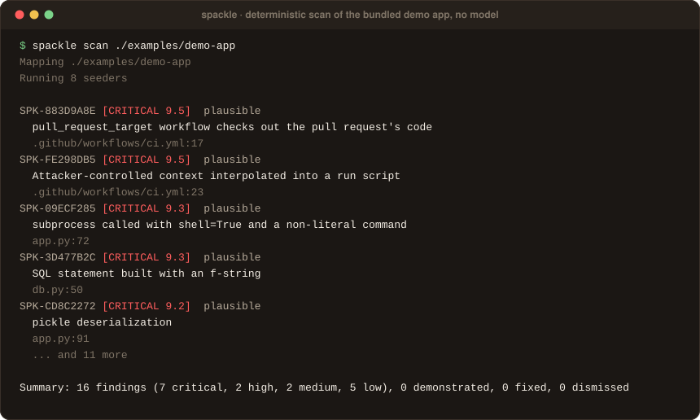
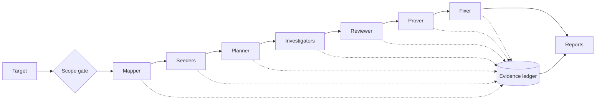

<div align="center">


<br>

[](https://github.com/TMHSDigital/Spackle/actions/workflows/ci.yml)
[](https://github.com/TMHSDigital/Spackle/releases)
[](https://pkg.go.dev/github.com/TMHSDigital/spackle)
[](https://scorecard.dev/viewer/?uri=github.com/TMHSDigital/Spackle)
[](LICENSE)
[](docs/PRIVACY.md)

### Agentic security and debugging that finds real flaws, proves them, explains how they would be exploited, and fixes them.

Point it at your own code, your own running application, or your own infrastructure files.<br>
It reports what is wrong, shows the evidence, says how sure it is, and hands you a checked patch.<br>
<sub>Built for developers, AppSec engineers and small security teams testing systems they own or are authorized to test.</sub>



**[Website](https://tmhsdigital.github.io/Spackle/)** &nbsp;·&nbsp; [Quick start](#quick-start) &nbsp;·&nbsp; [How it works](#how-it-works) &nbsp;·&nbsp; [Findings](#anatomy-of-a-finding) &nbsp;·&nbsp; [Running targets](#running-target-mode) &nbsp;·&nbsp; [CI](#ci) &nbsp;·&nbsp; [MCP](#mcp) &nbsp;·&nbsp; [Configuration](#configuration) &nbsp;·&nbsp; [Changelog](CHANGELOG.md)

</div>

> [!IMPORTANT]
> **Authorized use only.** Point Spackle at systems you own or have explicit written permission to test. Testing someone else's system without consent is not security work and may be a crime. You are responsible for complying with the laws that apply to you.

<details>
<summary><strong>Contents</strong></summary>

<br>

- [Quick start](#quick-start) · [Why Spackle](#why-spackle) · [How it works](#how-it-works)
- [Anatomy of a finding](#anatomy-of-a-finding)
- [Modes](#running-target-mode): [Running targets](#running-target-mode) · [Debug](#debug-mode)
- [Integrations](#ci): [CI](#ci) · [MCP](#mcp)
- [Configuration](#configuration) · [Privacy](#privacy)
- [Benchmark](#benchmark) · [Comparison](#comparison) · [Limits](#limits)
- [Security](#security) · [Contributing](#contributing) · [Acknowledgements](#acknowledgements) · [License](#license)

</details>

## Quick start

Spackle is one static binary. The first run below needs no model, no key and no container runtime.

<details open>
<summary><strong>Windows (PowerShell)</strong></summary>

<br>

```powershell
go install github.com/TMHSDigital/spackle/cmd/spackle@latest
git clone https://github.com/TMHSDigital/Spackle.git
cd Spackle
spackle scan .\examples\demo-app
```

</details>

<details>
<summary><strong>Linux and macOS</strong></summary>

<br>

```sh
go install github.com/TMHSDigital/spackle/cmd/spackle@latest
git clone https://github.com/TMHSDigital/Spackle.git
cd Spackle
spackle scan ./examples/demo-app
```

</details>

<details>
<summary><strong>Release archive</strong></summary>

<br>

Download an archive for your platform from [Releases](https://github.com/TMHSDigital/Spackle/releases). Each release has signed checksums, an SBOM and build provenance, and the release notes show how to verify them. A container image is published at `ghcr.io/tmhsdigital/spackle`; it holds only the binary, so use the archive for scans that run proofs in a sandbox.

</details>

That scan is deterministic: built-in rules plus any scanners you have installed. Every finding it prints is labelled `plausible`, because nothing has confirmed it yet. To have Spackle investigate, prove and fix, give it a model and a container runtime:

```sh
spackle doctor                     # what is installed, what is missing
export ANTHROPIC_API_KEY=...       # your own key; Spackle ships none
spackle scan ./examples/demo-app --provider anthropic --model claude-opus-5-5
```

Before a paid run Spackle prints an estimate and the hard caps, and waits for a yes. [Configuration](#configuration) covers OpenRouter, other OpenAI-compatible endpoints and fully local models.

<div align="right"><sub><a href="#readme">↑ back to top</a></sub></div>

## Why Spackle

| | |
| :--- | :--- |
| **Proof, not a hunch** | A finding is demonstrated by a proof of concept run in a sandbox, or by the recorded request and response for a running target. When nothing was run, the finding says so. |
| **The attacker's view** | Each finding gives preconditions, the attack step by step, what it chains into and the blast radius, written for the person who has to decide what to fix first. |
| **Fix and verify** | The fixer writes the smallest patch. It is accepted only if the changed files still compile, the proof stops working, and a passing test suite still passes. |
| **Runs offline** | Ollama and any local OpenAI-compatible server are first-class. `--offline` refuses every connection that would leave the machine. |
| **No listening ports** | Spackle is a command, not a server. Nothing binds a port, there are no default credentials, and a test fails the build if that ever changes. |
| **Evidence ledger** | Every run writes an append-only ledger. Reports are rebuilt from it alone, so a report is the same bytes every time. |
| **Honest confidence** | `demonstrated`, `high` or `plausible`, each with its reason. A separate reviewer tries to refute every finding, and what it refutes is listed with why. |
| **Your secrets stay put** | Secret detection runs before anything reaches a model. Reports name the rule, the location and a short hash, never the value. |

<div align="right"><sub><a href="#readme">↑ back to top</a></sub></div>

## How it works



- **Scope gate.** A live URL needs an authorized scope before a single request is sent. Local source does not.
- **Mapper and seeders** use no model. The mapper finds languages, frameworks, entry points and trust boundaries. Seeders produce leads from built-in rules (Go, Python, JavaScript and TypeScript, secrets, Dockerfiles, Kubernetes, Terraform, GitHub workflows) and from Semgrep, gitleaks, osv-scanner, Trivy and hadolint when they are installed. Leads are hints, not verdicts.
- **Planner** turns the map and the leads into a short list of questions worth answering.
- **Investigators** answer one question each with read-only tools confined to the target. Every draft is checked before it counts: quoted lines must exist in the file they cite, and the CVSS 4.0 score is computed by Spackle from the vector.
- **Reviewer** sees only the claim, not the reasoning, and tries to refute it.
- **Prover** writes a small proof of concept and runs it in a container with no network, no capabilities, a read-only root and a read-only copy of your source.
- **Fixer** returns whole files; Spackle computes the patch, checks it in the sandbox, and commits accepted fixes to `spackle/<run-id>` in a separate worktree. Your working tree is never touched.

Scope, budgets and tool permissions are enforced in code. Nothing in a target can change them, because no tool exists whose effect is to change them. [docs/ARCHITECTURE.md](docs/ARCHITECTURE.md) has the detail.

<div align="right"><sub><a href="#readme">↑ back to top</a></sub></div>

## Anatomy of a finding

Every finding has the same parts: identity, severity with its CVSS 4.0 vector, the flaw, the exploitation scenario, the proof, the blast radius, the remediation, and a confidence label with its reason. The one below is real output, from a running-target scan of the bundled demo app on localhost with no model configured. With a model, the exploitation scenario and remediation are written for the specific application instead of the class.

<details>
<summary><strong>A finding in full</strong></summary>

<br>

<!-- finding:start -->
#### SPK-9658B583: Path traversal in parameter name of /file

**Severity:** HIGH 8.7. **Confidence:** demonstrated. **Status:** open.

##### Identity

- **Id:** `SPK-9658B583`
- **Title:** Path traversal in parameter name of /file
- **Location:** `GET /file (parameter name)`
- **Class:** path-traversal
- **Surface:** running-target
- **CWE:** CWE-22
- **OWASP:** A01:2021 Broken Access Control
- **Status:** open

##### Severity

- **Label:** high
- **Score:** 8.7 (CVSS 4.0)
- **Vector:** `CVSS:4.0/AV:N/AC:L/AT:N/PR:N/UI:N/VC:H/VI:N/VA:N/SC:N/SI:N/SA:N`

**Reasoning**

Default CVSS 4.0 vector for this class, assuming the flaw is reachable as it typically is. Not refined by investigation.

##### The flaw

GET /file with name set to ..\\..\\..\\..\\..\\..\\windows\\win.ini returned status 200 with the content of a system file. The parameter is used as a file path without being confined to the intended directory, so any file the server process can read can be downloaded.

##### Exploitation scenario

**Preconditions**

- A file path is built from attacker-controlled input without being confined to a base directory
- The attacker can reach the feature that reads or writes the file

**Steps**

1. Submit a file name containing parent-directory sequences or an absolute path (these steps are typical for this class of flaw; they were not confirmed for this code)
1. Read files outside the intended directory, such as configuration files or keys
1. Overwrite files where the same flaw exists on a write path

**Chains into**

- Credential theft from configuration files and key material
- Remote code execution when an executable or configuration file can be overwritten

##### Proof of concept

- **Status:** demonstrated (the flaw's effect was observed: a proof of concept ran in the sandbox, or a recorded exchange shows it)
- **Kind:** http-sequence

**Summary**

The behavior was observed in the recorded exchange(s) X-0020.

**Captured result**

```text
; for 16-bit app support [fonts] [extensions] [mci extensions] [files] [Mail] MAPI=1
```

**Artifacts**

- `evidence/exchanges/X-0020.json`

##### Blast radius

**What the attacker gains**

- Read access to any file the application process can read
- Source code, configuration, and secrets stored on the server

##### Remediation

Resolve the requested name against a fixed base directory and refuse any result outside it, or map the parameter to an allowlist of files instead of using it as a path.

- **Verification:** unverified

##### Confidence

- **Level:** demonstrated (the flaw's effect was observed, by a sandboxed proof or a recorded exchange)
- **Reason:** Observed directly: the recorded request and response show it. Impact beyond what the exchange shows was not exercised.

##### Origin

- **Found by:** dast-baseline:path-traversal
<!-- finding:end -->

</details>

Reports render as terminal text, Markdown, HTML, JSON and SARIF. `spackle report <run-id> --format html` rebuilds any of them from the ledger. [docs/findings.md](docs/findings.md) documents every field.

<div align="right"><sub><a href="#readme">↑ back to top</a></sub></div>

## Verify a fix

A scan that writes a fix leaves the patch in `findings/<id>/fix.patch` and, in a git repository, on a `spackle/<run-id>` branch. Your code is not changed, so the finding has status `patch-available`. After you apply the patch or merge the branch, re-run the stored proofs against the code as it is now:

```shell
spackle verify latest
```

Each proof runs in the sandbox again. A proof that no longer succeeds marks its finding `fixed`; one that still succeeds keeps it open. The command exits 1 when any proof still succeeds or could not be run to an answer, and 0 when none does. It needs a container runtime, it works for runs of a local directory only (not for a git URL or a running target), and it updates the stored run: the outcomes are added to that run's ledger and its reports are rewritten. See [docs/findings.md](docs/findings.md#verifying-a-fix).

## Running-target mode

Point Spackle at an application you run. It crawls within scope, probes without changing state, and ties each finding to the stored request and response that show it.

```toml
# scope.toml
hosts = ["localhost:8081"]
statement = "My own dev server."
```

```sh
spackle scan http://localhost:8081 --authorize scope.toml
```

- Without a scope file or a `[scope]` table, Spackle asks you to type the host to confirm, once per run. With `--yes` or in CI it refuses instead of asking.
- Hosts match exactly. Redirects and links that leave scope are not followed. `localhost` and `127.0.0.1` are different hosts.
- Only GET, HEAD and OPTIONS are sent unless the scope file sets `allow_unsafe_methods = true`.
- With a model configured, an investigator assesses each observation and may send follow-up requests through the same scope and the same request cap.

<div align="right"><sub><a href="#readme">↑ back to top</a></sub></div>

## Debug mode

Start from a failing test or an issue. Spackle reproduces it in the sandbox, finds the root cause, writes a fix and verifies it.

```sh
spackle debug . --test TestCheckoutTotal
spackle debug . --issue bug-report.md --good v1.4.0   # bisect from a known good revision
```

Debug mode needs a model and a container runtime. Without them it tells you what is missing and prints the reproduction command it would have run.

<div align="right"><sub><a href="#readme">↑ back to top</a></sub></div>

## CI

```yaml
name: spackle
on: [pull_request]
permissions:
  contents: read
  security-events: write
jobs:
  scan:
    runs-on: ubuntu-latest
    steps:
      - uses: actions/checkout@v7
      - uses: TMHSDigital/Spackle@v0.1.0
        with:
          fail-on: high
```

The action installs a release, verifies its checksum and build provenance, runs the scan, and uploads SARIF so findings appear in GitHub code scanning. By default it runs the deterministic stages, which need no key and cost nothing. [docs/ci.md](docs/ci.md) shows how to add a model and lists every input.

## MCP

`spackle mcp` serves Spackle's tools to an MCP client over stdin and stdout. You set the limits on the command line and the model chooses only within them: it can scan directories under `--root`, read reports and findings, and nothing else. It cannot pick a provider, raise a budget or reach a live target.

```sh
claude mcp add spackle -- spackle mcp --root /absolute/path/to/project
```

[docs/mcp.md](docs/mcp.md) has the tool list and client configuration.

<div align="right"><sub><a href="#readme">↑ back to top</a></sub></div>

## Configuration

Spackle ships no model and no key. Configuration lives in `spackle.toml`; flags override it; API keys come only from environment variables.

```toml
[model]
provider = "openai-compatible"
base_url = "https://openrouter.ai/api/v1"
api_key_env = "OPENROUTER_API_KEY"
model = "anthropic/claude-opus-5-5"

[stages.mechanical]        # cheap stages can use a cheaper or local model
provider = "ollama"
model = "your-local-model"

[budget]
usd = 5
tokens = 2000000
wall_time = "30m"
```

| | |
| :--- | :--- |
| **Anthropic** | `--provider anthropic`, key in `ANTHROPIC_API_KEY` from the Anthropic console. A claude.ai subscription is not API access. |
| **OpenAI-compatible** | `--provider openai-compatible --base-url <url>`: OpenRouter, OpenAI, Azure OpenAI, Together, Groq, Fireworks. |
| **Local** | `--provider ollama`, or a localhost `--base-url` for llama.cpp, LM Studio and vLLM. Add `--offline` to guarantee nothing leaves the machine. |
| **Budgets** | Hard caps on tokens, spend, wall time, sandbox runs and findings. They cannot be turned off. When one is reached, the report lists what was skipped. |

`spackle doctor` validates the configured provider with a free round-trip before you spend anything. [docs/config.md](docs/config.md) has a copy-paste block for every provider.

## Privacy

| Mode | What leaves the machine |
| :--- | :--- |
| No model configured | Nothing from Spackle. Installed scanners may fetch their own vulnerability databases. |
| Hosted provider | Prompts, plus redacted excerpts of the files the model asks to read, go to the provider you chose. Secret values are replaced before sending. |
| Local model | Requests go to localhost only. |
| `--offline` | Any non-loopback connection by Spackle is refused, and a remote provider is rejected before the run starts. |

There is no telemetry and no update check. [docs/PRIVACY.md](docs/PRIVACY.md) has the full account.

<div align="right"><sub><a href="#readme">↑ back to top</a></sub></div>

## Benchmark

`bench/corpus` holds small fixture projects in Go, Python and TypeScript/JavaScript with planted, documented flaws, plus clean decoys that only look risky. `make bench` scores a run against the ground truth. This table is generated from the results files committed under [bench/results](bench/results) and is never edited by hand.

<!-- bench:start -->
| Date | Version | Model | Mode | Precision | Recall | Verified-fix rate | Cost per finding |
|---|---|---|---|---|---|---|---|
| 2026-11-22 | 0.1.0 | none | deterministic | 83.9% | 68.4% | n/a | n/a |
<!-- bench:end -->

Only the deterministic run is committed so far. An agentic row needs a run with a capable hosted or local model; when one is committed it will name the model, the date and the version, like the row above.

Small synthetic fixtures are not your codebase, and these numbers will not transfer to it unchanged. [docs/benchmark.md](docs/benchmark.md) explains the scoring and how to run it with your own model.

## Comparison

Spackle is new. Semgrep, CodeQL, Snyk, nuclei and the others are established, and each does something better than Spackle does; Spackle uses several of them as lead sources. [docs/comparison.md](docs/comparison.md) says what each does better, tool by tool.

## Limits

- Proofs and fixes are run automatically for Go, Python and TypeScript/JavaScript. Other languages get findings and analysis only.
- The sandbox has no network, so a proof can use the standard library and what is already in the repository, and nothing that would need installing.
- Without Docker or Podman nothing is executed: findings are reasoned, not demonstrated, and no fix is verified.
- This is agentic work. It needs a capable tool-calling model. Small local models produce malformed answers; Spackle rejects those and falls back to reporting leads, which is safe but not useful.
- Running-target mode sends plain HTTP requests. It does not drive a browser or log in for you.
- A model writes the proofs. `demonstrated` means the proof ran and printed an unguessable marker. Read the stored proof before you rely on it.

<div align="right"><sub><a href="#readme">↑ back to top</a></sub></div>

## Security

Report vulnerabilities in Spackle through [private vulnerability reporting](https://github.com/TMHSDigital/Spackle/security/advisories/new), not a public issue. [SECURITY.md](SECURITY.md) lists what counts, and [docs/THREAT_MODEL.md](docs/THREAT_MODEL.md) is the threat model of Spackle itself, residual risks included.

## Contributing

[CONTRIBUTING.md](CONTRIBUTING.md) covers setup on Windows and Unix, the checks CI runs, the benchmark, and DCO sign-off. Wrong or missed findings have their own issue form.

## Acknowledgements

ARTEX (by Autumn-27, AGPL-3.0) showed that a planner, workers and evidence-bound findings make a capable security agent. Spackle is the defender's take on that idea, written from scratch: no ARTEX code, prompts or assets are used.

Spackle runs these scanners when you have them, and is better for it: [Semgrep](https://semgrep.dev), [gitleaks](https://github.com/gitleaks/gitleaks), [osv-scanner](https://github.com/google/osv-scanner), [Trivy](https://trivy.dev) and [hadolint](https://github.com/hadolint/hadolint). CVSS 4.0 scoring uses [go-cvss](https://github.com/pandatix/go-cvss).

## License

[Apache-2.0](LICENSE).

<br>

<div align="center">

[Apache-2.0 License](LICENSE) &nbsp;·&nbsp; [Security policy](SECURITY.md) &nbsp;·&nbsp; [TM Hospitality Strategies](https://github.com/TMHSDigital)

</div>
