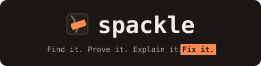
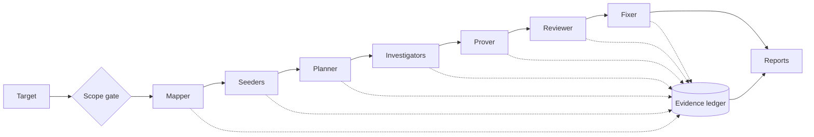

<div align="center">



<br>

[](https://github.com/TMHSDigital/Spackle/actions/workflows/ci.yml)
[](https://pkg.go.dev/github.com/TMHSDigital/spackle)
[](https://scorecard.dev/viewer/?uri=github.com/TMHSDigital/Spackle)
[](LICENSE)

### Agentic security and debugging that finds real flaws, proves them, explains how they would be exploited, and fixes them.

Point it at your own code, your own running application, or your own infrastructure files.<br>
<sub>Built for developers, AppSec engineers and small security teams testing systems they own or are authorized to test.</sub>

[Status](#status) &nbsp;·&nbsp; [How it works](#how-it-works) &nbsp;·&nbsp; [Principles](#principles) &nbsp;·&nbsp; [Build](#build-from-source) &nbsp;·&nbsp; [Docs](#documentation) &nbsp;·&nbsp; [Roadmap](ROADMAP.md) &nbsp;·&nbsp; [Changelog](CHANGELOG.md)

</div>

> [!IMPORTANT]
> **Authorized use only.** Point Spackle at systems you own or have explicit written permission to test. Testing someone else's system without consent is not security work and may be a crime. You are responsible for complying with the laws that apply to you.

## Status

> [!NOTE]
> Spackle is pre-release. This repository holds the foundation: the CLI skeleton, the test and release pipeline, and the design. The scanning pipeline is being built in the open, milestone by milestone. [ROADMAP.md](ROADMAP.md) lists what has landed, and this README only describes commands that work in the current `main`.

What works today:

| | |
| :--- | :--- |
| **CLI skeleton** | `spackle help` and `spackle version`. Every other command says plainly that it is not in this build yet. |
| **Invariant tests** | A test parses every Go file in the module and fails the build if any code opens a network listener. |
| **Pipeline** | CI on Linux, macOS and Windows across two Go versions, CodeQL, govulncheck, OpenSSF Scorecard, and a release workflow with signed checksums, an SBOM and build provenance. |

<div align="right"><sub><a href="#readme">↑ back to top</a></sub></div>

## How it works

This is the v0.1.0 design. Deterministic stages produce leads, model-driven stages investigate and prove them, and every event is written to an append-only ledger that the reports are rendered from.



- **Mapper and seeders** need no model. They map the target and collect leads from built-in rules and any installed scanners.
- **Planner and investigators** turn leads into hypotheses and chase them with a small, read-only tool set.
- **Prover** runs a proof of concept inside a container sandbox and records the result as evidence.
- **Reviewer** gets fresh context and tries to refute each finding.
- **Fixer** writes the smallest patch, re-runs the proof and the tests, and rejects a patch that regresses.

The full design is in [docs/ARCHITECTURE.md](docs/ARCHITECTURE.md).

<div align="right"><sub><a href="#readme">↑ back to top</a></sub></div>

## Principles

Four properties are built into the design and covered by tests as each part lands. [docs/THREAT_MODEL.md](docs/THREAT_MODEL.md) records the reasoning.

| | |
| :--- | :--- |
| **Authorized use, stated up front** | A live host or URL needs an explicit scope, confirmed once per run or read from a scope file. Local source does not. |
| **Spackle does not become the backdoor** | Nothing listens on a network port. There are no credentials to default. Everything in a target is treated as untrusted input, and scope, budgets and tool permissions are enforced in code where target content cannot reach them. |
| **Secrets stay put** | Secret detection and redaction run before any content goes to a model. Reports say that a secret exists and where, never its value. Local models and an offline mode are part of the design. See [docs/PRIVACY.md](docs/PRIVACY.md). |
| **Clean room** | Spackle takes architecture ideas from ARTEX and none of its code, prompts or assets. |

<div align="right"><sub><a href="#readme">↑ back to top</a></sub></div>

## Build from source

You need Go 1.26 or newer.

<details open>
<summary><strong>Windows (PowerShell)</strong></summary>

<br>

```powershell
git clone https://github.com/TMHSDigital/Spackle.git
cd Spackle
.\make.ps1 build
.\spackle.exe help
```

</details>

<details>
<summary><strong>Linux and macOS</strong></summary>

<br>

```sh
git clone https://github.com/TMHSDigital/Spackle.git
cd Spackle
make build
./spackle help
```

</details>

Run the checks CI runs with `make lint test` or `.\make.ps1 all`.

<div align="right"><sub><a href="#readme">↑ back to top</a></sub></div>

## Documentation

| | |
| :--- | :--- |
| [Architecture](docs/ARCHITECTURE.md) | Pipeline stages, packages, the ledger, and every dependency with its reason. |
| [Threat model](docs/THREAT_MODEL.md) | STRIDE over Spackle itself, residual risks, and the design decisions log. |
| [Privacy](docs/PRIVACY.md) | What leaves the machine in each mode. |
| [Comparison](docs/comparison.md) | How Spackle relates to ARTEX, Semgrep, CodeQL, Snyk, Copilot Autofix, nuclei, CAI and PentestGPT, including what each does better. |
| [Design spec](docs/superpowers/specs/2026-11-22-spackle-design.md) | The v0.1.0 design and the approaches that were rejected. |

## Security

Report vulnerabilities in Spackle through [private vulnerability reporting](https://github.com/TMHSDigital/Spackle/security/advisories/new), not a public issue. [SECURITY.md](SECURITY.md) lists what counts.

## Contributing

[CONTRIBUTING.md](CONTRIBUTING.md) covers setup on Windows and Unix, the checks, and DCO sign-off. Wrong or missed findings have their own issue form.

## Acknowledgements

ARTEX (by Autumn-27, AGPL-3.0) showed that a planner, workers and evidence-bound findings make a capable security agent. Spackle is the defender's take on that idea, written from scratch.

## License

[Apache-2.0](LICENSE).

<br>

<div align="center">

[Apache-2.0 License](LICENSE) &nbsp;·&nbsp; [Security policy](SECURITY.md) &nbsp;·&nbsp; [TM Hospitality Strategies](https://github.com/TMHSDigital)

</div>
