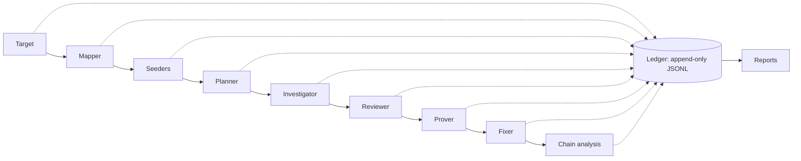

# Architecture

## Overview

Spackle is a command line tool that examines systems you own or are authorized to test. It covers three surfaces: source code, running web applications, and infrastructure files on disk. It also has a debug mode that starts from a failing test or an issue.

A run is a staged pipeline. Deterministic stages (mapper, seeders, the running-target probe) produce typed leads without a model. Model stages (planner, investigator, reviewer, prover, fixer) each get a narrow allowlisted tool set and must return typed JSON that the engine validates against the target. Every event is appended to a ledger, and reports are rendered from the ledger alone.

With no model configured, the run ends after the deterministic stages and reports each lead as a finding labelled `plausible` and `not-run`. A model adds investigation, review, proof and repair. A container runtime adds execution. Each is optional, and the labels on a finding say which were present.

Spackle is one static Go binary built with `CGO_ENABLED=0`. `cmd/spackle/main.go` only calls `cli.Main`. Everything else lives under `internal/`.

Two other designs were considered and rejected. A thin orchestrator over existing scanners cannot reason about reachability, prove a finding, or fix one. A general agent with a shell makes scope and budgets hard to enforce, makes runs hard to reproduce, and turns prompt injection from target content into command execution.

## Pipeline

This is the path for source on disk.



Solid arrows show the order of stages. Dotted arrows show writes to the ledger. Reports read the ledger and nothing else.

Investigations run one at a time. Each finding goes through review, proof and fix before the next investigation starts.

## Stages

Each stage lists what it reads, what it writes, and whether it uses a model.

### Target

- Reads: the path or URL on the command line.
- Writes: a classification (`path`, `git` or `url`) and, once the run starts, the `run.start` event.
- Model: no.

An existing path is always a directory target. A git remote is cloned (depth 1) into the state directory and then treated as a path. Any other `http` or `https` URL is a running target and takes the live path described below. A bare host name that is not an existing path is refused: Spackle will not guess that you meant a live host.

Everything that can refuse a run (a bad target, a missing key, an offline violation, an unconfirmed estimate) is checked before the run directory exists, so a refused run creates no run directory and no ledger. Mapping happens before the cost estimate is shown, so a git URL target has been cloned by then: a run that is refused, not confirmed or only a dry run removes that clone again. The map cache under `<state_dir>/cache/` can stay. `spackle runs` lists the stored runs, and `spackle runs prune` deletes old ones with their clones and fix worktrees.

### Mapper

- Reads: the target tree, through a file walk that never follows a symbolic link out of the root, skips dependency and version control directories, and skips binary files and files larger than 1 MiB. Everything skipped is recorded.
- Writes: a map (languages, frameworks, entry points, trust boundaries, infrastructure files, the test command) and a `map` event.
- Model: no.

The map is cached under the state directory, keyed by commit, and only when the target is the root of a git repository with no local changes.

### Seeders

- Reads: the file listing from the mapper.
- Writes: typed leads as `lead` events and one `seeder` event per seeder.
- Model: no.

Three seeders are built in: `builtin-code` (line rules for Go, Python, JavaScript and TypeScript), `builtin-secrets`, and `builtin-infra` (Dockerfiles, Kubernetes manifests, Terraform, GitHub workflows). Five more are adapters that run only when the scanner is on `PATH`: Semgrep, gitleaks, osv-scanner, Trivy and hadolint. One failing seeder does not stop the others.

A secret lead carries the file, the line, the rule and a short hash of the value. It never carries the value.

### Planner

- Reads: the map and the leads, enveloped as data.
- Writes: `intent` events, each a single question with files and lead ids, ordered by priority.
- Model: yes (`planner` stage).

The plan is validated against the real map and leads: references to files or leads that do not exist are removed, and an intent left with nothing to look at is dropped. A run plans at most 30 investigations. If the planner fails or returns nothing usable, intents are built directly from the leads and a note says so.

### Investigator

- Reads: one intent, plus the target through read-only tools: `read_file`, `list_dir`, `grep`, `find_symbol`, `find_references`, `git_log`, `git_show`.
- Writes: a typed draft, which becomes a finding only if it passes validation.
- Model: yes (`investigator` stage).

A draft is checked against the target: the class is known, the file exists, the lines are in range, every quoted line really appears in the file, and the CVSS vector is valid. A draft that fails is sent back once with the specific problems, then rejected and recorded as a `draft.reject` event. [findings.md](findings.md) lists the checks.

"No finding" is a valid result. The lead is then reported as dismissed, with the investigator's reason.

### Reviewer

- Reads: the finding's claim (title, class, location, description, flow, attack steps, vector) and the target through its own fresh tool registry. It does not see the investigator's reasoning or confidence.
- Writes: a `verdict` event.
- Model: yes (`reviewer` stage).

The reviewer tries to refute the finding. "Refuted" with a reason dismisses it. "Uncertain" keeps it open and lowers `high` confidence to `plausible`. "Confirmed" keeps it. A valid corrected CVSS vector replaces the investigator's.

### Prover

- Reads: a finding that is still open.
- Writes: the proof under `findings/<id>/poc/`, `sandbox.run` events, evidence files, and the proof status on the finding.
- Model: yes (`prover` stage).

The prover writes a small proof of concept. Spackle validates it (it may only add files under `spackle_poc/`, and its command must start with the language's own program) and runs it in the sandbox with a random marker. The finding is `demonstrated` when the run exits 0 and prints the marker. A proof that fails is sent back once with its output.

This stage is skipped, and the finding stays `reasoned`, when there is no container runtime or when the finding's file is not Go, Python, JavaScript or TypeScript.

### Fixer

- Reads: the finding, the target through read-only tools, and the proof if there is one.
- Writes: `fix.patch`, a `verdict` event, and the verification sentence on the finding.
- Model: yes (`fixer` stage).

The contract is whole files, not diffs: the fixer returns the complete new content of at most three existing files, and Spackle computes the unified diff itself. Patches written by a model are frequently malformed (wrong hunk counts, invented context), while a computed diff always applies. It also means Spackle knows exactly what the patched tree looks like when it checks it.

Each candidate is checked in the sandbox, against a copy of the target with the new files:

1. The changed files compile or parse.
2. The proof of concept, when there is one, no longer succeeds.
3. The project's own tests still pass, when they passed on the unmodified code.

A candidate that fails is sent back with the reason, up to `max_attempts` times. A finding becomes `patch-available` only when the proof stopped working against the patched code. It becomes `fixed` when `spackle verify` shows the proof no longer succeeds against the code itself. With no proof to re-run, a patch that passes the other checks is offered as `unverified` and the finding stays open.

After all investigations, accepted patches are committed to a branch `spackle/<run-id>` in a new git worktree under the state directory, and only when the fixed files are tracked by git. The working tree, the index and the current branch are never touched. `--pr` pushes the branch and opens a draft pull request through the GitHub CLI.

### Chain analysis

- Reads: the open findings (id, title, class, location, gains, preconditions).
- Writes: `kill_chain` and `related` on the findings that combine.
- Model: yes (`mechanical` stage).

Optional. It is skipped when the budget is gone, and it never fails the run. Chains that name unknown finding ids are ignored.

### Reports

- Reads: the ledger only.
- Writes: terminal, Markdown, HTML, JSON and SARIF 2.1.0.
- Model: no.

Rendering uses no clock, no environment and no map iteration order, so the same ledger always produces the same bytes. `spackle report` re-renders a stored run. `spackle verify` re-runs stored proofs in the sandbox against the current code, appends the outcomes to the same ledger, and rewrites the reports.

### Budget caps across stages

Caps on tokens, spend, wall time and sandbox runs are checked before every model call and every container run. When one is reached, no new work starts, what was found is kept, and a `budget.skip` event lists what was not examined. The report shows that list. Caps cannot be turned off. [config.md](config.md#budgets) has the defaults.

## Running targets

A URL takes a different path. Its findings rest on recorded traffic, not on sandboxed code.

1. **Scope gate.** `authz.Gate` runs first. It takes a scope file (`--authorize`), the `[scope]` table, or on a terminal a typed confirmation of the exact host, and returns a grant. Nothing is sent and no run directory is created until it passes. This applies to loopback targets too.
2. **Scope-bound client.** The HTTP client is built from the grant and cannot be built without one. Every request, and every redirect hop, is checked against the grant's hosts, path prefixes and methods. The client also enforces the request cap and the rate limit.
3. **Baseline probe.** With no model, the probe crawls within scope (up to 40 pages) and runs fixed checks: security headers, cookie flags, version headers, CORS, verbose errors and stack traces, directory listings, well-known exposed files, reflected input, SQL error signatures, open redirects and path traversal on file-like parameters. It sends GET requests and harmless marker values. State-changing methods are sent only when the scope allows them.
4. **Exchange evidence.** Every request and response is written to `evidence/exchanges/<id>.json` the moment it happens, with credential headers masked and bodies redacted, and an `http.exchange` event points at it. An interrupted run still shows exactly what was sent.
5. **Findings from the probe.** Each probe lead becomes a finding whose proof is its recorded exchanges. Where the exchange shows the behavior itself, the finding is `demonstrated`. Where it shows only a symptom, such as a SQL error, the finding is `reasoned`, because exploiting it would not be non-destructive.
6. **Model assessment.** With a model, the investigator assesses each probe finding in turn. It is given the finding and its recorded exchanges, enveloped, and one tool: `http_request`, bound to the same client. The tool has no argument that reaches the scope, the request cap or the rate limit. The model confirms the finding (and rewrites its explanation, severity and remediation) or says it is not confirmed, which dismisses it with the reason. Evidence ids the model cites are kept only if those exchanges were really recorded.

The model assesses what the probe found. It does not explore endpoints the probe did not flag, and there is no prover or fixer on this path. Both are on the [roadmap](../ROADMAP.md).

## Debug mode

`spackle debug` starts from a failing test (`--test`) or an issue description (`--issue`), on a local directory. It needs a model and a container runtime, and refuses without them, saying what it could determine and which command it would have run.

1. **Reproduce.** A named test is run in the sandbox with a command Spackle builds from the validated test name. For an issue, the model writes a reproduction script, under the same rules as a proof of concept.
2. **Bisect.** With `--good <revision>`, Spackle searches the commits between that revision and HEAD, using the reproduction as the oracle. Each commit is exported to a temporary directory and run in the sandbox. The working tree is never checked out or changed. A bisect uses at most 12 sandbox runs.
3. **Diagnose and fix.** The model reads the failure and the code and returns a root cause and whole-file changes. Spackle computes the patch and checks it in the sandbox: the changed files compile, the reproduction no longer fails, and the project's tests pass.
4. **Report.** The result is one finding with surface `debug` and class `bug`. The fix is a patch file in the run folder, and a branch in a new worktree when the files are in git. `--pr` is not used in debug mode.

## Package layout

Every directory under `internal/`:

| Package | Responsibility |
| :--- | :--- |
| `agent` | The model-driven stages: planner, investigator, endpoint assessment, reviewer, chain analysis, prover, fixer, debugger. The shared tool loop, draft validation and the prompts. `agent/tools` is the allowlisted read-only tool registry |
| `authz` | The authorized-scope gate for running targets: scope file parsing, host, port, path and method matching, the typed confirmation |
| `bench` | The benchmark corpus loader, runner, scoring and results files |
| `budget` | Hard caps on tokens, spend, wall time and sandbox runs, and stagnation detection |
| `cli` | Subcommand dispatch, flags, help with the authorized-use notice, exit codes |
| `config` | `spackle.toml` loading over defaults, validation, per-stage model resolution |
| `dast` | The scope-bound HTTP client, crawl, baseline probe, exchange capture, and the `http_request` tool |
| `diffx` | Unified diffs computed from old and new file content |
| `engine` | The pipeline for one run: scan, running-target scan, prove and fix, verify, debug. Writes the ledger, the evidence folders and the reports |
| `envelope` | Wraps untrusted content in nonce-delimited blocks and neutralizes forged delimiters |
| `finding` | The finding schema, validation, CVSS 4.0 scoring, class defaults, deduplication and ranking |
| `gitx` | Git through its command line, with hooks and other code-running features disabled: commit lookup, clone, worktree, commit, archive, draft pull request |
| `lang` | The table of languages with proof and fix support: the programs a proof may start, the default sandbox image, the compile check and the single-test command |
| `ledger` | The append-only `ledger.jsonl` writer and reader, and the event payload types |
| `llm` | The provider interface and its implementations (Anthropic, OpenAI-compatible, Ollama, a scripted fake), pricing, the redacting wrapper and the offline guard |
| `mapper` | The target map, built with no model: languages, frameworks, entry points, trust boundaries, test command. Cached by commit |
| `mcp` | The MCP server over standard input and output |
| `policy` | Tests only. Enforces repository-wide invariants, such as no listener anywhere in the module |
| `redact` | Secret detection and redaction, used by seeders, tools, evidence writers and the provider wrapper |
| `report` | Loads a run from its ledger and renders terminal, Markdown, HTML, JSON and SARIF 2.1.0 |
| `sandbox` | Runs untrusted code in a locked-down container by driving the `docker` or `podman` command line |
| `seed` | Lead producers: built-in rules for code, secrets and infrastructure files, and adapters for external scanners |
| `target` | Classifies a target as a path, a git remote or a running URL |
| `textx` | The one rune-safe helper that clips a string before it goes into a ledger event, a prompt or an error message |
| `version` | Build metadata set by the linker |
| `walk` | The safe file listing and path resolution every stage uses to read the target |

## Enforcement lives in code, not prompts

The system prompt tells the model that target content is data. Spackle does not rely on the model obeying that. The properties below are enforced in Go.

- **One constructor for live requests.** `authz.Gate` is the only way to obtain a grant, and the HTTP client and the `http_request` tool cannot be built without one. A zero grant permits nothing.
- **Scope is checked on every request.** Hosts match exactly, with no wildcards and no DNS. Redirects are followed by Spackle itself, hop by hop, and one that leaves the scope is refused and recorded.
- **No tool changes the rules.** The tool registry is read-only. No tool exists whose effect is to change scope, budgets or permissions, so nothing a model or a target says can change them.
- **Tool arguments are confined.** Paths are resolved against the target root, and a path that leaves it, including through a symbolic link, is refused. Unknown arguments are refused. Output sizes are capped by constants no argument can raise.
- **Model output is typed and checked.** Every model stage returns JSON that is validated against the target before it is used.
- **Severity is computed.** The model proposes a CVSS 4.0 vector. Spackle validates it and computes the score.
- **A model cannot claim a demonstration.** Only a sandbox run that exits 0 and prints the run's random marker sets `demonstrated`.
- **Untrusted content is enveloped.** Target content reaches a model only between delimiters that carry a per-run random nonce. An occurrence of the nonce inside the content is removed before wrapping.
- **Redaction wraps every provider.** `llm.Redacting` wraps every provider, so the system prompt, user text, tool results and replayed tool arguments all pass through secret detection first. Tools redact their own output as well.
- **No listener.** A test walks the Go syntax tree of the module and fails on any `net.Listen`, `http.ListenAndServe` or `http.Server` use outside test files.
- **No self-authorization over MCP.** The MCP server scans local directories inside the operator's roots only. A running target is refused there, and a model client cannot spend money unless the operator started the server with `--allow-model`. See [mcp.md](mcp.md).

## Ledger and reproducibility

Each run writes `<state_dir>/runs/<run-id>/ledger.jsonl`. Run ids have the form `YYYYMMDD-HHMMSS-<6 hex>`, in UTC. The file holds one JSON object per line with the keys `seq`, `ts`, `parent`, `type` and `data`. `seq` is dense and starts at 1. `parent` is the sequence number of the event that caused this one.

| Event type | Data |
| :--- | :--- |
| `run.start` | Run id, version, command, target, commit, mode, provider, model, scope, isolation |
| `map` | Map summary |
| `seeder` | One seeder's status: available, leads, error |
| `lead` | One lead |
| `intent` | One planned investigation |
| `model.call` | Stage, provider, model, token counts, cost. No prompt and no completion |
| `tool.call` | Stage, tool, redacted and clipped arguments, result size. No result content |
| `sandbox.run` | Purpose, image, command, exit code, isolation, a pointer to the output file |
| `http.exchange` | Method, URL, status, a pointer to the stored exchange |
| `draft.reject` | A model result that was rejected, and why |
| `verdict` | A change to a finding's standing: reviewer, prover, fixer or verify |
| `finding.upsert` | One finding in full |
| `budget.skip` | Which cap was reached and what was not examined |
| `note` | A plain sentence for the report |
| `run.end` | Outcome: `completed`, `budget-exhausted`, `interrupted` or `failed`. A later run can continue a `budget-exhausted` or `interrupted` scan (`scan --resume`); its `run.start` names this run in `resumed_from` |

The ledger file is created exclusively and opened for append only, with mode 0600 in a 0700 directory. The reader rejects a file with a missing, reordered or truncated event. The ledger is not cryptographically chained. See [THREAT_MODEL.md](THREAT_MODEL.md) for what that means.

## Sandbox profile

`sandbox` shells out to the `docker` or `podman` command line. Every run gets these arguments:

| Setting | Value |
| :--- | :--- |
| Network | `--network none` |
| Capabilities | `--cap-drop ALL` |
| Privilege escalation | `--security-opt no-new-privileges` |
| Root filesystem | `--read-only` |
| Writable areas | tmpfs at `/work` (1 GiB) and `/tmp` (512 MiB) |
| Process count | `--pids-limit 256` |
| Memory | `--memory 1024m`, with `--memory-swap` set to the same value |
| CPU | `--cpus 2` |
| User | `65534:65534` |
| Wall-clock timeout | 2 minutes, enforced by the host. The container is removed afterwards |

The limits are configurable under `[sandbox]`. The flags are not.

The target is mounted read-only at `/src` and copied into `/work` inside the container, so the working tree cannot be modified. Proof files and patched files are staged in a private temporary directory, mounted read-only, and copied over the source. This form of copy-on-write works on Docker Desktop for Windows.

The only shell text Spackle ever runs in a container is a fixed bootstrap script. The command arrives as positional parameters, so nothing supplied by a model or a target is parsed as shell. A failed copy is reported as a sandbox error, never as "the proof no longer reproduces".

`network = "scope"` attaches the runtime's default bridge network instead. Spackle does not filter that traffic. The profile actually used is recorded on each proof.

With no runtime, nothing model-written is executed.

## Providers and cost accounting

`llm.Provider` is a small interface: a name, a model, whether the endpoint is local, and

```go
Complete(ctx context.Context, req Request) (Response, error)
```

Tool calling, stop reasons and usage are normalized across three wire shapes: Anthropic Messages, OpenAI Chat Completions and Ollama chat. A scripted `fake` provider lets every model stage be tested with no key and no network.

- **Per-stage selection.** `planner`, `investigator`, `prover`, `reviewer`, `fixer` and `mechanical` each resolve to a model, defaulting to `[model]`.
- **Keys.** API keys are read only from environment variables. Config names the variable.
- **Cost.** A built-in table prices Anthropic first-party models. `[pricing]` overrides and extends it. A cost the provider reports itself (OpenRouter) is used as is. A local model costs nothing. An unpriced remote model is recorded as cost unknown, and the dollar cap cannot be enforced for it. An unattended run with a dollar cap the operator set is refused for such a model unless `allow_unpriced` is on.
- **Estimated usage.** When a provider reports no usage, tokens are estimated at four bytes per token and marked as estimated.
- **Retries.** A request is tried up to three times on a transient failure. Redirects from a provider are never followed, so a key is never replayed to another host.
- **Offline.** `--offline` refuses a provider whose endpoint is not loopback before any request, and installs a dialer that refuses every non-loopback address. A private LAN address is not local.

[config.md](config.md#providers) has the provider settings and the price table.

## Dependencies

The direct dependencies in `go.mod`:

| Module | Why |
| :--- | :--- |
| `github.com/BurntSushi/toml` | Parses `spackle.toml` and scope files, and reports unknown keys so a typo cannot silently change a scope or a budget |
| `go.yaml.in/yaml/v3` | Parses Kubernetes manifests and CI workflows for the infrastructure rules |
| `github.com/pandatix/go-cvss` | CVSS 4.0 validation and scoring. The scoring tables are easy to get subtly wrong, and a wrong score misranks every finding |

Everything else is the standard library: the command line (`flag`), SARIF, the MCP server and HTML rendering (`html/template`).

**Providers use `net/http` directly, with no vendor SDK.** Spackle needs one endpoint per provider. Every dependency of a security tool is attack surface that has to be audited and kept patched, and three request shapes written by hand are a smaller audited surface than three SDKs and what they pull in.

**The container runtime is driven through its command line.** No runtime SDK is linked into the binary. The same code drives Docker and Podman, and the exact argument vector is unit-tested without a runtime.

**Git and the GitHub CLI are also driven as programs,** with argument vectors and never through a shell. When Spackle calls git, repository hooks are disabled, and so are text conversion filters and external diff programs where a commit is shown, so a target repository cannot run code through git.

A new dependency needs a reason recorded in this section.

## What Spackle deliberately does not have

- **No daemon.** Spackle runs as a command and exits. Nothing stays resident.
- **No database.** State is the ledger and the files next to it under the state directory.
- **No web UI.** A local web UI is a roadmap item.
- **No listener.** No package opens a port. The MCP server speaks over standard input and output only.
- **No shell tool for the model.** Model stages get read-only tools. Model-written code runs only in the sandbox, and without a runtime it does not run at all.
- **No default credentials.** There is no account system, so there is nothing to default.
- **No telemetry and no update check.** See [PRIVACY.md](PRIVACY.md).
