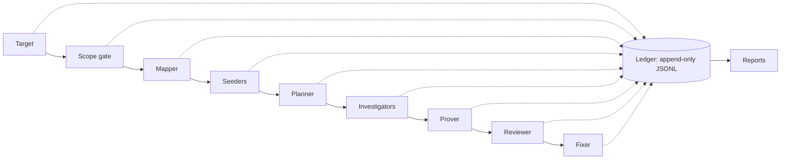

# Architecture

Status: this describes the v0.1.0 design. `ROADMAP.md` tracks which milestones have landed.

## Overview

Spackle is a command line tool that examines systems the operator owns or is authorized to test. It covers three surfaces: source code, running targets, and infrastructure files on disk. It also has a debug mode that starts from a failing test or an issue.

A run is a staged pipeline. Deterministic stages (mapper, seeders) produce typed leads without a model. Model stages (planner, investigators, prover, reviewer, fixer) each get a narrow allowlisted tool set, a budget slice, and typed JSON output that the engine validates. Every event is written to an append-only ledger, and reports are rendered from the ledger alone.

Spackle is one static Go binary built with `CGO_ENABLED=0`. `cmd/spackle/main.go` only calls `cli.Main`. Everything else lives under `internal/`.

Two other designs were considered and rejected. A thin orchestrator over existing scanners cannot reason about reachability, prove a finding, or fix one. A general agent with a shell makes scope and budgets hard to enforce, makes runs hard to reproduce, and turns prompt injection from target content into command execution.

## Pipeline



Solid arrows show the order of stages. Dotted arrows show writes to the ledger. Reports read the ledger and nothing else.

## Stages

Each stage below lists what it reads, what it writes, and whether it uses a model.

### Target

- Reads: the path or URL given on the command line.
- Writes: a classification (local path, git URL, or live URL) and the `run.start` ledger event.
- Model: no.

A git URL is cloned and then treated as local source. The classification decides whether the scope gate applies.

### Scope gate

- Reads: the classified target, a scope file passed with `--authorize`, a `[scope]` table in config, or a typed confirmation of the exact host.
- Writes: a live-target handle bound to the authorized hosts, ports, and path prefixes.
- Model: no.

A live URL, host, or cloud account requires the gate. Local paths and cloned git URLs do not. Loopback targets still require confirmation. In `--yes` and CI mode the gate requires a scope file or a `[scope]` table, because no one is present to type a confirmation.

### Mapper

- Reads: the target source tree.
- Writes: a target map (languages, frameworks, entry points, trust boundaries, test and build commands) and a `map` ledger event. The map is cached by commit SHA.
- Model: no.

### Seeders

- Reads: the source tree and the map.
- Writes: typed leads as `lead` ledger events.
- Model: no.

Seeders are lead producers. Some are adapters for external scanners (Semgrep, gitleaks, osv-scanner, Trivy, hadolint). Others are built-in rules for code, secrets, Dockerfiles, Kubernetes manifests, Terraform, and CI workflows. Secret leads carry the file, line, rule, and a short hash of the value. They never carry the value.

If no provider is configured the run stops after this stage. Leads are reported as findings with confidence `plausible` and proof status `not-run`.

### Planner

- Reads: the map and the leads.
- Writes: intents, each with a scope, a hypothesis, and a budget share, ordered by expected severity.
- Model: yes.

### Investigators

- Reads: one intent each, plus the target through read-only tools.
- Writes: a typed finding draft.
- Model: yes.

The engine rejects a draft that fails schema validation or cites a location that does not exist. For a running target, investigators get an `http_request` tool bound to the same scope and caps as the DAST client.

### Prover

- Reads: a finding draft.
- Writes: a proof of concept under the finding folder, `sandbox.run` ledger events, and a proof status on the finding.
- Model: yes.

The prover builds a proof of concept and runs it in the sandbox. A passing proof promotes confidence to `demonstrated`. With no container runtime, nothing model-written is executed, the proof status is `not-run`, and the finding is labelled reasoned. Auto-run proofs cover Go, Python, and TypeScript/JavaScript in v0.1.

### Reviewer

- Reads: the finding and the target through tools. It does not read the investigator transcript.
- Writes: a `verdict` ledger event and `review.md` in the finding folder.
- Model: yes.

The reviewer starts with fresh context and tries to refute the finding. A refuted finding is dismissed. The reason stays in the ledger.

### Fixer

- Reads: a finding that survived review, and a worktree copy of the source.
- Writes: `fix.patch`, a branch, and a verification status on the finding.
- Model: yes.

The fixer writes the smallest patch it can, then re-runs the tests and the proof of concept in the sandbox. It rejects a patch that regresses the tests or fails to close the proof. The number of attempts is capped.

### Reports

- Reads: the ledger only.
- Writes: terminal, Markdown, HTML, JSON, and SARIF 2.1.0 output.
- Model: no.

### Budget caps across stages

Any cap being hit stops new work and lets in-flight validation finish. The engine records a `budget.skip` ledger event that lists what was not examined, and the report shows that list.

## Package layout

All packages live under `internal/`.

| Package | Responsibility |
|---|---|
| `cli` | Subcommand dispatch, flags, exit codes, help with the authorized-use notice |
| `config` | `spackle.toml` loading, flag and env merge, per-stage provider selection |
| `target` | Classify a target: local path, git URL, live URL. Decides whether the scope gate applies |
| `authz` | Authorized-scope gate: scope file parsing, host and CIDR matching, per-run confirmation |
| `mapper` | No-LLM target map: languages, frameworks, entry points, trust boundaries, test and build commands. Cached by commit SHA |
| `seed` | Lead producers. External scanner adapters (Semgrep, gitleaks, osv-scanner, Trivy, hadolint) plus built-in rules for code, secrets, Dockerfile, Kubernetes, Terraform and CI workflows |
| `redact` | Secret detection and redaction. Used by seeders (to report location, never value) and by the provider wrapper |
| `envelope` | Wraps untrusted content in nonce-delimited data blocks and neutralizes delimiter forgery |
| `llm` | Provider interface and implementations: `anthropic`, `openai` (compatible), `ollama`, `fake` (recorded). Usage and cost normalization. Offline guard |
| `budget` | Hard caps: tokens, USD, wall time, sandbox runs, findings. Stagnation detection |
| `ledger` | Append-only `ledger.jsonl` writer and reader with causal parents |
| `finding` | Finding schema, validation, CVSS 4.0 scoring, dedup, ranking |
| `agent` | Planner, investigator, reviewer, prover, fixer loops and the allowlisted tool registry |
| `sandbox` | Container runtime abstraction (Docker, Podman): isolation profile, limits, copy-on-write source |
| `dast` | Scope-bound HTTP client, baseline probe, crawl, request and response capture |
| `debug` | Debug mode: reproduce, bisect, root cause, fix, verify |
| `gitx` | Git plumbing: commit SHA, worktree and branch creation, bisect, clone |
| `report` | Renderers: terminal, Markdown, HTML, JSON, SARIF 2.1.0. Input is a ledger only |
| `mcp` | Stdio MCP server (JSON-RPC 2.0 over stdin and stdout) |
| `bench` | Corpus runner and scoring (precision, recall, verified-fix rate, cost per finding) |

## Enforcement lives in code, not prompts

The system prompt tells the model that target content is data. Spackle does not rely on the model obeying that. The properties below are enforced in Go.

- **One constructor for live targets.** `authz.Gate` is the only constructor for a live-target handle. The DAST HTTP client and the investigator `http_request` tool take that handle as a required argument. There is no code path to a live request without it.
- **Scope is checked on every request.** A scope lists hosts, ports, and path prefixes. Redirects and links that leave the scope are refused and logged.
- **No tool changes the rules.** Scope, budgets, and tool permissions live in Go. No tool exists that can change them.
- **Tool arguments are validated.** Paths are confined to the target root and hosts are confined to the scope, whatever the model asks for.
- **Model output is typed and checked.** Each model stage returns JSON that the engine validates. A draft that cites a location that does not exist is rejected.
- **Severity is computed.** The model proposes a CVSS 4.0 vector. The engine validates the vector and computes the score.
- **Untrusted content is enveloped.** Target content reaches a model only inside an `envelope` block with a per-run random nonce. The envelope neutralizes attempts to forge the delimiter.
- **Redaction wraps every provider.** `llm.Redacting` wraps every provider, so every outbound message and tool result passes through `redact` first.
- **No listener.** A test walks the Go AST of the module and fails on any `net.Listen`, `http.ListenAndServe`, or `http.Server` use outside test files.
- **No self-authorization over MCP.** Live targets through MCP require a scope file path. The typed confirmation is not available over MCP, so a model client cannot authorize itself.

## Finding schema

`finding.Finding` carries these fields:

| Field | Content |
|---|---|
| `id`, `title`, `class`, `cwe[]`, `owasp[]` | Identity and classification |
| `location` | File and line range, or endpoint, method, and parameter |
| `severity` | CVSS 4.0 vector, score, label, reasoning |
| `flaw` | Description plus `flow[]` steps, each quoting real code or traffic |
| `exploitation` | Preconditions, steps, `chains_into` |
| `proof` | Status (`demonstrated`, `reasoned`, `not-run`), kind, artifact paths, captured result, isolation in effect |
| `blast_radius` | Gains, exposed, kill chain with related finding ids |
| `remediation` | Summary, patch as unified diff, why, defense in depth, verification status, branch |
| `confidence` | `demonstrated`, `high`, or `plausible`, with a reason |
| `origin` | Seeders and stages that contributed |
| `status` | `open`, `dismissed`, or `fixed` |

## Ledger and reproducibility

Each run writes `.spackle/runs/<run-id>/ledger.jsonl`. Run ids have the form `YYYYMMDD-HHMMSS-<6 hex>`. The file holds one JSON object per line with these keys: `seq`, `ts`, `parent`, `type`, `data`. The `parent` key records the causal parent of an event.

Event types include `run.start`, `map`, `lead`, `model.call`, `tool.call`, `sandbox.run`, `http.exchange`, `finding.upsert`, `verdict`, `budget.skip`, and `run.end`.

Each finding has a folder that holds `finding.json`, `poc/`, `fix.patch`, `evidence/`, and `review.md`.

`spackle report` reads only the ledger. It renders with no clock, no map iteration order, and no environment input, so repeated renders of the same ledger are byte-identical.

The ledger is append-only by convention and file mode. It is not cryptographically chained in v0.1. See `docs/THREAT_MODEL.md` for what that means.

## Sandbox profile

`sandbox.Runtime` shells out to the `docker` or `podman` CLI. The default profile is:

| Setting | Value |
|---|---|
| Network | `--network none` |
| Capabilities | `--cap-drop ALL` |
| Privilege escalation | `--security-opt no-new-privileges` |
| Root filesystem | `--read-only`, with a tmpfs work area |
| Process count | `--pids-limit` |
| Memory and CPU | Limited |
| User | Non-root |
| Wall-clock timeout | Enforced by the host |

Source is not bind-mounted read-write. It is mounted read-only and copied to the work area inside the container, so the working tree cannot be modified. This form of copy-on-write was chosen because it works on Docker Desktop for Windows.

A run may widen the network setting to reach an authorized DAST scope. The profile actually used is recorded on each proof.

With no runtime, nothing model-written is executed and proofs are marked `not-run`.

Language images are the official `golang`, `python`, and `node` images. They are pinned by tag in config and can be overridden. `spackle doctor` reports whether they are present locally.

## Providers and cost accounting

`llm.Provider` has one method:

```go
Complete(ctx, Request) (Response, error)
```

A request carries messages and tool definitions. A response carries a normalized `Usage{InputTokens, OutputTokens, Estimated bool}`. Tool calling is normalized across three shapes: Anthropic Messages, OpenAI Chat Completions, and Ollama chat. A `fake` provider replays recorded responses so tests need no API key.

- **Per-stage selection.** The stages `planner`, `investigator`, `reviewer`, `prover`, `fixer`, and `mechanical` each resolve to a provider config. Each defaults to the run default.
- **Keys.** API keys come only from environment variables named in config.
- **Cost.** Cost comes from a small built-in price table that config can override. An unknown model costs `0` and is marked `cost_unknown`.
- **Estimated usage.** When a provider omits usage, tokens are estimated at 4 bytes per token and marked estimated.
- **Budgets.** `budget` enforces hard caps on tokens, USD, wall time, sandbox runs, and findings, and detects stagnation.
- **Offline.** `--offline` installs a dialer that refuses any non-loopback address. Provider construction fails early if the base URL is not loopback. A private-range LAN address is not treated as local.

## Dependencies

| Module | Why |
|---|---|
| `github.com/BurntSushi/toml` | `spackle.toml` parsing. No transitive dependencies |
| `go.yaml.in/yaml/v3` | Parsing Kubernetes manifests and CI workflows for the infra rules |
| `github.com/pandatix/go-cvss` | Correct CVSS 4.0 scoring |

Everything else is the standard library, including the CLI (`flag`), HTTP providers, SARIF, MCP, and HTML rendering (`html/template`). The container runtime is driven through its CLI, so no runtime SDK is linked into the binary.

## What Spackle deliberately does not have

- **No daemon.** Spackle runs as a command and exits. Nothing stays resident.
- **No database.** State is the ledger and the files next to it under `.spackle/`.
- **No web UI.** A local web UI is a roadmap item and is not in v0.1.
- **No listener.** No package opens a port. The MCP server speaks over stdin and stdout only.
- **No shell tool for the model on the host.** Model stages get a narrow allowlisted tool set. Model-written code runs only in the sandbox, and without a runtime it does not run at all.
- **No default credentials.** There is no account system, so there is nothing to default.
