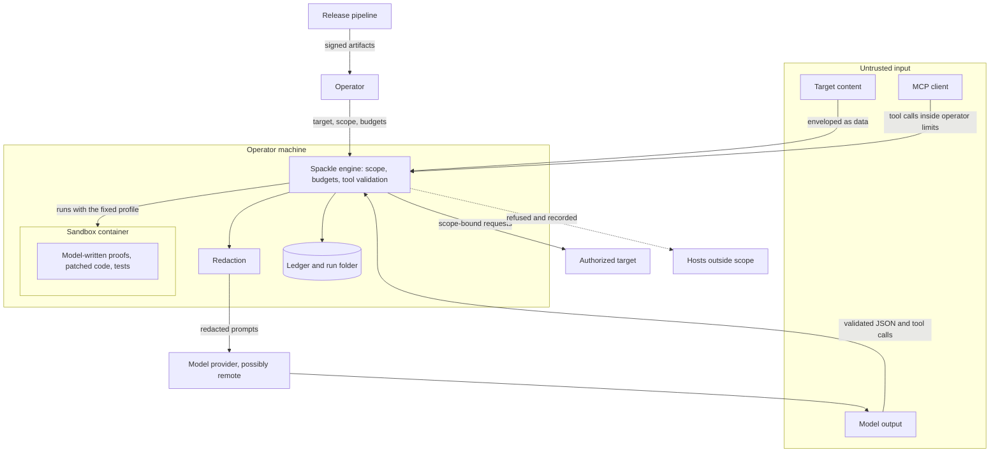

# Threat model

This document models threats to Spackle itself and to the people around a Spackle run. It does not model the systems Spackle examines. Each "Verified by" cell names a test in this repository, as `package: TestName`. Packages are under `internal/`.

## Scope and assets

Spackle protects these assets:

| Asset | Why it matters |
| :--- | :--- |
| Your secrets and source | Spackle reads the source tree, which may contain credentials and private code |
| Your machine | Spackle runs with your privileges and handles hostile input |
| The authorized target | Testing must stay non-destructive by default and inside the agreed scope |
| Third parties outside scope | A request to a host you did not authorize may be illegal and harmful |
| API spend | Model calls cost money, and a run can be driven to make more of them |
| Release artifacts | Users run the published binaries with their own privileges |

## Trust boundaries

| Party | Trust | Notes |
| :--- | :--- | :--- |
| Operator | Trusted | Chooses the target, the scope, the provider and the budgets |
| Target content | Untrusted | Source files, HTTP responses, scanner output, commit messages, issue text. Any of it may be written by an attacker |
| Model provider | Semi-trusted, possibly remote | Receives redacted prompts. Trusted to return completions, not trusted with secrets |
| Model output | Untrusted | May be wrong, or steered by injected target content. Validated before use |
| MCP client | Untrusted | A model on the other end of standard input. Works inside limits the operator set on the command line |
| Container runtime | Trusted to isolate | Docker or Podman, driven through its command line. Spackle depends on its isolation and does not add to it |
| Release pipeline | Trusted, verifiable | GitHub Actions builds, signs and attests the artifacts |

## STRIDE analysis

### Spoofing

| Threat | Where | Mitigation | Verified by |
| :--- | :--- | :--- | :--- |
| Target content imitates system or operator instructions to the model | Any model stage that reads target content | Target content reaches a model only between delimiters that carry a per-run random nonce. An occurrence of the nonce inside content is removed before wrapping, and labels cannot break the opening marker. The engine does not depend on the model obeying: scope, budgets and tool permissions live in Go | `envelope: TestInjectionCorpus`, `TestForgedMarkersCannotCloseTheEnvelope`, `TestLeakedNonceIsNeutralized`, `TestLabelCannotBreakTheOpeningMarker`; `agent/tools: TestInjectionCorpus`, `TestEnvelope` |
| A model claims a finding is demonstrated | Investigator drafts | Only `high` and `plausible` are accepted from a model. `demonstrated` is set only by a sandbox run that exits 0 and prints the run's random marker | `agent: TestModelCannotAwardItselfDemonstrated`; `engine: TestProveThenFixThenVerify` |
| A model cites code or traffic that does not exist | Investigator drafts, endpoint assessment | Every quote is checked against the file it cites. Evidence ids are kept only if the exchange was recorded | `agent: TestDraftRejections`, `TestLineNumbersAreCorrectedFromTheQuote`; `engine: TestLiveModelAssessmentCannotLeaveScope` |
| A model client authorizes a running target or a paid run on its own behalf | MCP server | The MCP `scan` tool accepts only a local directory inside an operator root. Operator settings are not tool arguments. Without `--allow-model` the model is removed from the configuration before a scan | `mcp: TestScanRefusesEverythingButADirectoryInsideARoot`, `TestOperatorSettingsAreNotArguments`, `TestModelIsStrippedWithoutAllowModel`, `TestUnknownArgumentIsRefused` |
| A URL disguises its real host with userinfo | Scope gate, HTTP client | Userinfo is never used for matching and never sent | `authz: TestPermitsHosts`; `dast: TestUserinfoIsNeverSent` |
| A scoped hostname is rebound to a different IP address | HTTP client, `http_request` tool | Not mitigated. Scope is matched by name and port without DNS. See residual risks | `authz: TestPermitsHosts`, `TestPermitsNamesLoopbackAliasing` cover the name and port rules only |
| A user installs a binary that did not come from the project | Release download | Checksums are signed with cosign keyless signing, and archives carry build provenance attestations and an SBOM. The GitHub Action checks the checksum and the attestation before it runs the binary | Verification by the user or the action. There is no unit test for this |

### Tampering

| Threat | Where | Mitigation | Verified by |
| :--- | :--- | :--- | :--- |
| Model-written code modifies the working tree or the host | Prover, fixer, debug mode | Model-written code runs only in the sandbox. Source is mounted read-only and copied inside the container. The root filesystem is read-only. With no runtime, nothing model-written is executed | `sandbox: TestBuildArgsRequiredArguments`, `TestBuildArgsForbiddenArguments`, `TestIntegrationSourceMountIsReadOnly`, `TestIntegrationRootFilesystemIsReadOnly`; `engine: TestNoRuntimeMeansNothingIsExecuted` |
| A proof replaces a file of the target, or a fix edits the test or the proof | Prover, fixer | A proof may only add files under `spackle_poc/`. A fix may only change existing files that are not test or proof files | `agent: TestReproduceRejectsScriptsThatReplaceTargetFiles`; `engine: TestPatchThatDoesNotCloseTheProofIsRejected`, `TestPatchThatBreaksTheBuildIsRejected` |
| A model-written command is interpreted by a shell | Sandbox | The only shell text is a fixed bootstrap. The command is passed as positional parameters. Mount paths that could inject mount options are refused | `sandbox: TestBuildArgsBootstrapIsFixed`, `TestBuildArgsRejectsMountOptionInjection`, `TestIntegrationHostileCmdIsNotInterpreted` |
| A fix lands in the operator's working tree or current branch | Fixer | Patches go to a file in the run folder and to a new branch in a separate worktree | `engine: TestFixesLandOnABranchAndLeaveTheWorkingTreeAlone`; `gitx: TestWorktreeLeavesWorkingTreeUntouched` |
| A target repository runs code through git | Git calls | Hooks are disabled on every git call. Text conversion and external diff are disabled when a commit is shown. Arguments that look like options are refused | `gitx: TestOptionInjectionIsRefused`; `agent/tools: TestGitRefusals`, `TestGitStaysInsideTargetSubdirectory` |
| The ledger is edited after a run to hide or invent events | `ledger.jsonl` | A ledger is created exclusively, appended only, and never overwritten. The reader rejects missing, reordered and truncated events. It is not cryptographically chained. See residual risks | `ledger: TestCreateRefusesToOverwrite`, `TestReadDetectsMissingEvent`, `TestReadReportsTruncatedLine` |
| Malicious scanner output injects fake leads or instructions | External scanner adapters | Scanner output is parsed into typed leads. Lead text is enveloped before a model sees it. A lead that fails validation is rejected. Drafts must quote real code, and the reviewer tries to refute each finding from fresh context | `engine: TestInvalidLeadIsRejectedNotReported`, `TestReviewerRefutationDismissesWithReason`; `agent: TestPlanValidatesAgainstTheRealTarget` |
| Target content changes the scope, budget or tool permissions | Any model stage | No tool exists that can change them. Hostile tool requests are refused and the run continues | `agent: TestHostileToolRequestsAreRefusedAndTheRunContinues`; `agent/tools: TestConfinement`, `TestCallErrors` |
| Target content breaks out of a report | HTML, Markdown, terminal and JSON reports | Every renderer escapes target content for its format | `report: TestInjectionHTML`, `TestInjectionMarkdown`, `TestInjectionTerminal`, `TestInjectionJSON` |
| A dependency or CI action is replaced with a malicious version | Build and release | Three direct dependencies. GitHub Actions are pinned by commit SHA. Releases carry an SBOM and provenance | Dependency review and provenance verification. There is no unit test for this |

### Repudiation

| Threat | Where | Mitigation | Verified by |
| :--- | :--- | :--- | :--- |
| An operator denies having authorized a running target | Scope gate | Authorization is explicit: a scope file, a `[scope]` table, or a typed confirmation of the exact host. The scope, its source and the operator's statement are recorded in the ledger | `authz: TestGateNoScope`, `TestGateInteractive`, `TestGatePrecedence`; `engine: TestLiveScanStaysInScopeAndRecordsEvidence` |
| A finding cannot be traced to its evidence | Reports | Reports are a pure function of the ledger. Each running-target finding links to its stored exchanges. Each sandbox run is a ledger event with its isolation profile and an output file | `engine: TestReportIsReproducibleFromTheLedgerAlone`, `TestLedgerRecordsEverySandboxRun`; `report: TestRenderIsDeterministic`, `TestGolden` |
| Work skipped under a budget cap goes unnoticed | Budget enforcement | A `budget.skip` event lists what was not examined, and the report shows the list | `engine: TestBudgetExhaustionDegradesAndSaysWhatWasSkipped`, `TestMaxFindingsIsRecordedAsSkipped` |
| A dismissed finding disappears without a reason | Reviewer | A dismissal requires a reason, and the reason is kept on the finding and in the ledger | `engine: TestReviewerRefutationDismissesWithReason`, `TestInvestigatorNoFindingDismissesTheLead`; `agent: TestReviewVerdicts` |
| A report overstates what was shown | Reports | Confidence and proof status are printed with what they mean | `report: TestHonestLabels` |

### Information disclosure

| Threat | Where | Mitigation | Verified by |
| :--- | :--- | :--- | :--- |
| A secret value is sent to a model provider | Every provider call | `llm.Redacting` wraps every provider: system prompt, user text, tool results and replayed tool arguments pass through secret detection. Tools redact their own output first | `llm: TestRedactingKeepsSecretsFromTheProvider`, `TestRedactingDropsRawTurnThatContainsASecret`; `agent: TestSecretsInTargetNeverReachTheModel`; `engine: TestSecretsNeverReachTheModelInAFullRun`, `TestDebugSecretInFailureOutputNeverReachesTheProvider` |
| A secret value appears in the ledger, the evidence or a report | Seeders, ledger, evidence, reports | Secret leads carry the file, line, rule and a short hash of the value, never the value. Sandbox output and recorded exchanges are redacted before they are stored | `engine: TestSecretValuesNeverReachTheRunDirectory`; `redact: TestApplyNeverLeaksAnyPlantedSecret`, `TestMatchCarriesNoValue`; `dast: TestExchangeRedaction` |
| An API key is taken from a flag or a config file, or sent to another host | Configuration, provider clients | Keys are read only from environment variables. The config has no key field, and a value that looks like a key is rejected. Provider clients never follow redirects | `config: TestNoAPIKeyFieldExists`, `TestValidationProblems`; `llm: TestNewKeyHandling` |
| Injected content tells the model to read files outside the target | Read tools | Paths are confined to the target root. Symbolic links that leave it are refused | `agent/tools: TestConfinement`, `TestSymlinkEscapeIsRefused`, `TestOutsideFileIsNeverReadable`; `walk: TestResolveRefusesSymlinkEscape`, `TestListRefusesSymlinkOutOfRoot` |
| Injected content tells the model to send data to another host | `http_request` tool, sandbox | The tool reaches only the authorized scope. The source-code tools have no network at all. The sandbox has no network by default | `dast: TestHTTPToolOutOfScope`, `TestDoOutOfScopeSendsNothing`; `engine: TestLiveModelAssessmentCannotLeaveScope`; `sandbox: TestIntegrationDefaultProfileHasNoNetwork` |
| `--offline` leaks traffic to a remote address | Provider and running-target clients | A provider whose endpoint is not loopback is refused before any request. The dialer refuses every non-loopback address. A remote running target is refused | `llm: TestNewRefusesRemoteProvidersWhenOffline`, `TestOfflineDialerRefusesNonLoopback`, `TestLoopbackDetection`; `engine: TestOfflineRefusesARemoteLiveTarget` |
| A request leaves the authorized scope through a redirect or a followed link | HTTP client, crawler, `http_request` tool | Redirects are followed by Spackle itself, each hop checked against the scope. Out-of-scope links are not fetched | `dast: TestRedirectOutOfScopeNotFollowed`, `TestSuppliedClientCannotFollowRedirects`, `TestBaselineOpenRedirectIsNotFollowed`, `TestDoRefusesPathOutsidePrefix` |
| An MCP client reads outside the roots or outside the runs directory | MCP server | Paths are resolved, including symbolic links, and must be inside a root. A run id that contains a path separator is refused | `mcp: TestScanRefusesASymlinkThatLeavesTheRoot`, `TestRunIDCannotNameAPath` |
| Source excerpts reach a hosted provider | Model stages | By design when a hosted provider is configured. [PRIVACY.md](PRIVACY.md) states what is sent. A local model or no model avoids it | Documented behavior, not a defect |

### Denial of service

| Threat | Where | Mitigation | Verified by |
| :--- | :--- | :--- | :--- |
| Target content drives the run to spend without limit | Model stages | Hard caps on tokens, spend, wall time and sandbox runs, a turn limit per conversation, and stagnation detection. Caps cannot be turned off and no tool can raise them | `budget: TestCapsCannotBeTurnedOff`, `TestEachCapTrips`, `TestStagnation`; `agent: TestBudgetExhaustionStopsTheLoop`, `TestTurnLimitAsksForAFinalAnswer`, `TestStagnationStopsARepeatingModel`; `engine: TestSandboxRunCapIsEnforced` |
| An MCP client multiplies load or spend | MCP server | Tool calls run one at a time. `max_findings` can only lower the configured limit. Oversized messages are rejected | `mcp: TestToolCallsRunOneAtATime`, `TestMaxFindingsOnlyLowersTheLimit`, `TestOversizedMessageIsRejected` |
| A proof forks without bound, exhausts memory or never ends | Sandbox | Process, memory and CPU limits, and a wall-clock timeout enforced by the host that kills and removes the container | `sandbox: TestBuildArgsRequiredArguments`, `TestIntegrationTimeoutKillsContainer`, `TestRunFakeTimeoutKillsStuckCLI`, `TestRunFakeOutputCap` |
| A hostile repository contains huge files, binaries or pathological lines | Mapper, seeders, read tools | Files over 1 MiB and binary files are skipped and recorded. Tool output is capped by constants no argument can raise | `walk: TestListSkipsDependencyDirsBinariesAndHugeFiles`; `agent/tools: TestReadFileRefusesOversizeFile`, `TestGrepLongLineDoesNotHang`, `TestTruncation` |
| A hostile target returns an endless body or an endless redirect chain | HTTP client | At most 1 MiB of a response is read. Redirects stop at 5 hops and count against the request cap | `dast: TestBodyCapsAndUTF8`, `TestRedirectHopLimit`, `TestRequestCapStopsRedirectChain` |
| Spackle overloads or damages the authorized target | Running-target probe | A request cap and a rate limit bound every run. Probes use safe methods and harmless marker values. State-changing methods need `allow_unsafe_methods` in the scope, and a redirect never repeats a state-changing request | `dast: TestRequestCap`, `TestRateLimitSleeps`, `TestPostNeedsUnsafeMethods`, `TestBaselineUnsafeForms`, `TestRedirectDoesNotRepeatPost`; `authz: TestCaps`, `TestPermitsMethods` |

### Elevation of privilege

| Threat | Where | Mitigation | Verified by |
| :--- | :--- | :--- | :--- |
| Injected content tries to run commands on the host | Model stages | The model has no shell tool. Tools are read-only and come from a fixed registry. Model-written code runs only in the sandbox | `agent: TestHostileToolRequestsAreRefusedAndTheRunContinues`; `agent/tools: TestDefsAndNames`, `TestRandomArgsNeverPanic`; `engine: TestNoRuntimeMeansNothingIsExecuted` |
| Model-written code escapes the container to the host | Sandbox | No network, all capabilities dropped, no new privileges, read-only root, an unprivileged user. A kernel or runtime vulnerability is outside this control. See residual risks | `sandbox: TestBuildArgsRequiredArguments`, `TestBuildArgsForbiddenArguments`, `TestIntegrationProcessIsNotRoot`, `TestIntegrationDefaultProfileHasNoNetwork` |
| Spackle is used as a backdoor into the operator machine | Whole module | No package opens a listener. MCP speaks over standard input and output only. There are no credentials to default | `policy: TestNoListenersInModule` |
| Spackle sends traffic to a target nobody authorized | Scope gate | A running target requires a scope or a typed confirmation of the exact host, loopback included. With `--yes` or no terminal there is no prompt, so a scope is required. A wrong scope source is a refusal, never a fall-through | `authz: TestGateNoScope`, `TestGateLoopbackStillNeedsScope`, `TestGatePrecedence`, `TestZeroAndNilGrant`; `engine: TestLiveTargetIsRefusedWithoutAuthorizedScope`; `dast: TestNewClientNeedsGrant` |
| A model fixes its own finding by breaking the program | Fixer | A patch must compile, must not regress a passing test suite, and must make the proof stop working | `engine: TestPatchThatBreaksTheBuildIsRejected`, `TestPatchThatDoesNotCloseTheProofIsRejected`, `TestDebugFixThatBreaksTheSuiteIsUnverified` |
| A test command chosen by target content runs on the host | Test runs in scan and debug | The suite and single-test commands are one of a fixed set the mapper picks, or `[test]` from the operator's config file, never text the target or a model supplies. They are argument vectors with no shell, run only in the sandbox, and a `[test]` command is named in the run notes. A `spackle.toml` read from inside the scanned project is operator configuration and should be reviewed as such | `engine: TestScanUsesTheConfiguredTestCommand`, `TestDebugUsesTheConfiguredTestCommands`; `config: TestTestCommands` |
| `--pr` publishes model-written changes without review | Fixer | A pull request is opened only when asked, and always as a draft | `engine: TestPRFlagOpensADraftPullRequestOnlyWhenAsked` |

A gate cannot stop an operator who lies about authorization. The gate makes authorization explicit and records it in the ledger. It prevents a run from reaching a running target by accident, and it leaves a record of who claimed what.

## Residual risks

These are known and accepted for v0.1.0.

- **"Demonstrated" means the proof ran, not that the proof is right.** A proof of concept is model-written. A finding is `demonstrated` when its proof ran in the sandbox, exited 0 and printed an unguessable marker. A careless proof could do that without truly exercising the flaw. Three things stand against it: the proof is stored in the run folder for you to read, the fixer must make the same proof fail before a fix is accepted, and the review of the finding stays independent of the proof. Read the proof before you rely on it.
- **DNS rebinding of a scoped hostname.** Scope is matched by host name and port, without DNS, and every redirect hop is re-checked. Resolved addresses are not pinned. Whoever controls DNS for a scoped name can point it at an address you did not intend, including an internal one. Use an IP address in the scope where that matters.
- **The ledger is not tamper-evident.** It is append-only by file mode and convention: created exclusively, opened for append, never rewritten by Spackle. It is not cryptographically chained or signed. Anyone with write access to the run folder can alter it consistently, and Spackle will not detect that.
- **Proofs are limited by the sandbox.** The sandbox has no network by default, so a proof can use only the language's standard library and what is already in the repository. A real flaw that needs a database server, an installed package or another service cannot be demonstrated, and stays `reasoned`.
- **Container escape relies on the container runtime.** Spackle configures the container conservatively and depends on the runtime and the kernel for isolation. A vulnerability in either is outside Spackle's control. So is a runtime the operator has configured to be weaker than its defaults.
- **`network = "scope"` is not filtered.** It attaches the runtime's ordinary bridge network. Model-written code then has whatever network access the runtime gives a container. Spackle does not restrict it to the authorized scope.
- **Redaction is pattern based.** It finds secrets by rule and by entropy heuristics, and it will miss a secret in an unusual format. A missed secret can reach a provider, the ledger, the evidence or a report.
- **A target directory inside an unrelated git repository.** A directory can sit under a repository it is not really part of, such as a temporary folder inside a home directory that is itself a repository. Spackle treats a target as "in git" only when its files are tracked: it records a commit only then, and creates a fix branch only when the fixed files are tracked, so an untracked target gets patch files only. Two edges remain. The read-only git history tools run git in the target directory, limited to the target's path, so they still talk to the enclosing repository, and a commit named by hash is shown with its message. And a tracked subdirectory of a larger repository gets its fix branch and worktree in that larger repository.
- **An operator who lies to the scope gate.** The gate does not verify ownership. A false scope file or a typed host name sends traffic to a system the operator has no right to test. The record of the claim is in the ledger.
- **Source reaches hosted providers.** Source excerpts and target traffic are sent to the configured provider with detected secrets removed. The content itself is not hidden.
- **Prompt injection still affects quality.** Enforcement in code stops injected content from changing scope, budgets or tools. It does not stop injected content from misleading a model into a wrong or missed finding. Draft validation and the reviewer reduce this and do not remove it.
- **External programs.** Semgrep, gitleaks, osv-scanner, Trivy, hadolint, git, the GitHub CLI and the container runtime run as separate programs with your privileges. Their own vulnerabilities and network behavior are outside Spackle's control, and `--offline` does not constrain them.
- **Evidence is sensitive.** The run folder holds source excerpts, captured traffic and working proofs. It is created with owner-only permissions, and that is all that protects it.

## Design decisions log

- **2026-11-22: providers over raw HTTP with no SDK.** Each provider is one endpoint spoken through `net/http`. Three hand-written request shapes are a smaller surface to audit and keep patched than three vendor SDKs and their dependencies.
- **2026-11-22: `--offline` means loopback only.** A private LAN address is refused, because offline promises that nothing leaves the machine and a LAN host is another machine. The check is on the resolved address, so a name that looks local and is not is refused too.
- **2026-11-22: API keys only from environment variables.** Config names the variable and never holds the key, so a key cannot be committed with a config file or appear in a process list through a flag.
- **2026-11-22: prompts and completions are not stored in the ledger, only accounting.** A `model.call` event records stage, model, tokens and cost. Prompts hold source excerpts and would double the amount of sensitive text on disk, while the findings and evidence already record what the run concluded.
- **2026-11-22: the fixer returns whole files and Spackle computes the patch.** Diffs written by a model are often malformed. A computed diff always applies, and Spackle knows exactly which tree it verified.
- **2026-11-22: a fix is accepted only when the proof stops working.** A finding is marked fixed only if the proof of concept that demonstrated it no longer succeeds against the patched code, with the code still compiling and a passing suite still passing. A patch with no proof to re-run is offered as unverified and the finding stays open.
- **2026-11-22: fix branches only for git-tracked files, in a separate worktree.** The working tree, the index and the current branch are never touched, and a target that merely sits under some unrelated repository does not get a branch created there.
- **2026-11-22: git hooks, text conversion and external diff are disabled when Spackle calls git.** A target repository is untrusted, and these are the ways a repository runs code through git.
- **2026-11-22: running-target probes are read-only by default, and SQL injection is reported as reasoned.** The probe sends safe methods and harmless markers. A SQL error is strong evidence, and exploiting the injection to prove it would not be non-destructive, so the finding is labelled reasoned and not demonstrated.
- **2026-11-22: MCP exposes local directories only and runs deterministic unless the operator passes `--allow-model`.** A model client cannot type a host to confirm scope or consent to spending, so those decisions stay on the operator's command line.
- **2026-11-22: an invalid model-supplied CVSS vector falls back to the class default.** Weaker models often produce a malformed vector, and that alone should not discard a finding whose evidence checks out. The score still comes from a real vector, and the reasoning says it is an estimate.
- **2026-11-22: `--pr` opens a draft pull request.** A patch written by a model should be read by a person before it is merged, and a draft says so.
- **2026-11-22: CVSS 4.0 scoring uses a library.** `github.com/pandatix/go-cvss` scores the vector. Reimplementing the scoring tables invites subtle errors that would misrank every finding.
- **2026-11-22: budget caps cannot be disabled.** Zero means the default and a negative value is an error, so no configuration and no injected text can produce an unbounded run.
