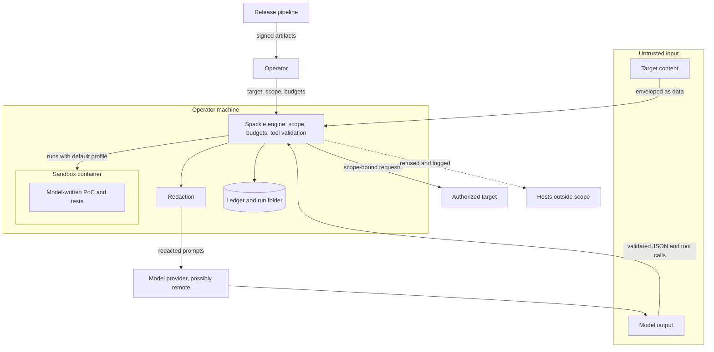

# Threat model

Status: this describes the v0.1.0 design. `ROADMAP.md` tracks which milestones have landed.

This document models threats to Spackle itself and to the people around a Spackle run. It does not model the systems Spackle examines. The "Verified by" columns name the kind of test the design calls for. A test exists only once its milestone has landed.

## Scope and assets

Spackle protects these assets:

| Asset | Why it matters |
|---|---|
| Operator secrets and source | Spackle reads the source tree, which may contain credentials and private code |
| The operator machine | Spackle runs with the operator's privileges and handles hostile input |
| The authorized target | Testing must stay non-destructive by default and inside the agreed scope |
| Third parties outside scope | A request to a host the operator did not authorize may be illegal and harmful |
| API spend | Model calls cost money, and a run can be driven to make more of them |
| Release artifacts | Users run the published binaries and images with their own privileges |

## Trust boundaries

| Party | Trust | Notes |
|---|---|---|
| Operator | Trusted | Chooses the target, the scope, the provider, and the budgets |
| Target content | Untrusted | Source files, HTTP responses, scanner output, issue text. Any of it may be written by an attacker |
| Model provider | Semi-trusted, possibly remote | Receives redacted prompts. Trusted to return completions, not trusted with secrets |
| Model output | Untrusted | May be wrong, or steered by injected target content |
| Container runtime | Trusted to isolate | Docker or Podman, driven through its CLI. Spackle depends on its isolation and does not add to it |
| Release pipeline | Trusted, verifiable | GitHub Actions builds, signs, and attests the artifacts |

## STRIDE analysis

### Spoofing

| Threat | Where | Mitigation | Verified by |
|---|---|---|---|
| Target content imitates system or operator instructions to the model | Any model stage that reads target content | Target content reaches a model only inside an `envelope` block with a per-run random nonce. The envelope neutralizes delimiter forgery. The engine does not depend on the model obeying: scope, budgets, and tool permissions live in Go | Injection suite |
| A model client authorizes a live target on its own behalf | MCP server | Live targets through MCP require a scope file path. The typed confirmation is not available over MCP | Scope gate tests |
| A scoped hostname is rebound to a different IP address (DNS rebinding) | DAST client, `http_request` tool | v0.1 pins scope by hostname and port and re-checks every redirect. It does not pin resolved IP addresses. See residual risks | Scope gate tests (hostname, port, and redirect checks only) |
| A user installs a binary or image that did not come from the project | Release download | Artifacts are signed with cosign keyless signing and carry build provenance attestations and an SBOM | Signature and provenance verification by the user |

### Tampering

| Threat | Where | Mitigation | Verified by |
|---|---|---|---|
| Model-written PoC or test code modifies the working tree or the host | Prover, fixer, debug mode | Model-written code runs only in the sandbox. Source is mounted read-only and copied inside the container. The root filesystem is read-only with a tmpfs work area. With no runtime, nothing model-written is executed | Sandbox argument and integration tests |
| The ledger is edited after a run to hide or invent events | `.spackle/runs/<run-id>/ledger.jsonl` | The ledger is append-only by convention and file mode. It is not cryptographically chained in v0.1. See residual risks | None in v0.1 beyond ledger writer unit tests |
| Malicious scanner output injects fake leads or instructions | Seeders that adapt external scanners | Scanner output is parsed into typed leads. Lead text is target content, so it is enveloped before any model sees it. Drafts that cite a location that does not exist are rejected. The reviewer tries to refute each finding from fresh context | Injection suite |
| Target content changes the scope, budget, or tool permissions | Any model stage | No tool exists that can change them. Tool arguments are validated against the run scope whatever the model asks | Injection suite, scope gate tests |
| A dependency or CI action is replaced with a malicious version | Build and release | Three direct dependencies. GitHub Actions are pinned by commit SHA. Releases carry an SBOM and provenance | Provenance verification, dependency review in CI |

### Repudiation

| Threat | Where | Mitigation | Verified by |
|---|---|---|---|
| An operator denies having authorized a live target | Scope gate | Authorization is explicit: a scope file, a `[scope]` table, or a typed confirmation of the exact host. The authorization is recorded in the ledger | Scope gate tests |
| A finding cannot be traced to its evidence | Reports | Reports are a pure function of the ledger. Each DAST finding links to the stored request and response pair. Each proof records the isolation profile actually used | Golden files for the report formats |
| Work skipped under a budget cap goes unnoticed | Budget enforcement | A `budget.skip` event lists what was not examined, and the report shows the list | Budget unit tests |
| A dismissed finding disappears without a reason | Reviewer | The refutation reason stays in the ledger | Stage unit tests with the fake provider |

### Information disclosure

| Threat | Where | Mitigation | Verified by |
|---|---|---|---|
| A secret value is sent to a model provider | Every provider call | `llm.Redacting` wraps every provider. Every outbound message and tool result passes through `redact` first | Redaction-before-provider test (a test provider asserts no planted secret arrives) |
| A secret value appears in the ledger or a report | Seeders, ledger, reports | Secret findings carry the file, line, rule, and a short hash of the value, never the value | Redaction-before-provider test, golden files for the report formats |
| Injected content tells the model to exfiltrate secrets or source | Model stages with tools | Hosts in tool arguments are confined to the scope. Paths are confined to the target root. The sandbox has no network by default. Redaction applies to tool results | Injection suite, scope gate tests |
| `--offline` leaks traffic to a remote address | Provider and HTTP clients | `--offline` installs a dialer that refuses any non-loopback address. Provider construction fails early if the base URL is not loopback. Private-range LAN addresses are not treated as local | Offline dialer test |
| A request leaves the authorized scope through a redirect or a followed link | DAST client, crawler, `http_request` tool | Every redirect and link is checked against the scope. Those that leave it are refused and logged | Scope gate tests |
| Source excerpts reach a hosted provider | Model stages | By design when a hosted provider is configured. `docs/PRIVACY.md` states what is sent. A local model or no model avoids it | Not a defect, documented behavior |

### Denial of service

| Threat | Where | Mitigation | Verified by |
|---|---|---|---|
| Target content drives the run to spend without limit (cost exhaustion) | Model stages | Hard caps on tokens, USD, wall time, sandbox runs, and findings, plus stagnation detection. Caps live in Go and no tool can raise them | Budget unit tests, injection suite |
| A PoC forks without bound or exhausts memory | Sandbox | `--pids-limit`, memory and CPU limits, and a wall-clock timeout enforced by the host | Sandbox argument and integration tests |
| A hostile repo contains symlinks that point outside the target root | Mapper, seeders, read tools | Tool path arguments are confined to the target root. The design does not yet state how symlinks are resolved. See residual risks | Injection suite (path confinement) |
| A hostile repo contains very large files | Mapper, seeders, read tools | Token and wall-time budgets bound model work. The design does not yet state a per-file size limit. See residual risks | Budget unit tests |
| Spackle overloads or damages the authorized target | DAST | Rate limiting and a request cap. Probes are non-destructive by default: GET and safe parameter mutation. State-changing methods require `dast.allow_unsafe_methods` in the scope file | Scope gate tests |

### Elevation of privilege

| Threat | Where | Mitigation | Verified by |
|---|---|---|---|
| Injected content tries to run commands on the host | Model stages | The model has no shell tool on the host. Tools come from an allowlisted registry. Model-written code runs only in the sandbox | Injection suite |
| Injected content tries to widen the scope or raise budgets | Model stages | Scope and budgets live in Go and no tool can change them | Injection suite, scope gate tests |
| Model-written PoC code escapes the container to the host | Sandbox | `--network none`, `--cap-drop ALL`, `--security-opt no-new-privileges`, read-only root, non-root user. A kernel or runtime vulnerability is outside this control. See residual risks | Sandbox argument and integration tests |
| Spackle is used as a backdoor into the operator machine | Whole module | No package opens a listener. MCP is stdio only. No credentials exist to default | No-listener AST test in `internal/policy` |
| Spackle is misused against a target the operator has no right to test | Scope gate | A live target requires a scope file or a typed confirmation of the exact host. Help text and documentation carry the authorized-use notice. See the note below | Scope gate tests |

A gate cannot stop a determined operator who lies about authorization. The gate makes authorization explicit and records it in the ledger. It prevents a run from reaching a live target by accident, and it leaves a record of who claimed what.

## Residual risks

These are known and accepted for v0.1.

- **DNS rebinding.** Scope is pinned by hostname and port, and every redirect is re-checked. Resolved IP addresses are not pinned. An attacker who controls DNS for a scoped hostname can point it at an address the operator did not intend, including an internal one.
- **Ledger tampering.** The ledger is append-only by convention and file mode. It is not cryptographically chained or signed. Anyone with write access to the run folder can alter it, and Spackle will not detect the change.
- **Operator misuse.** The scope gate does not verify ownership of a target. An operator who writes a false scope file can run against a system they have no right to test.
- **Sandbox escape through the runtime.** Spackle configures the container conservatively and depends on the runtime and the kernel for isolation. A vulnerability in either is outside Spackle's control.
- **Widened sandbox network.** A run may widen the sandbox network to reach an authorized DAST scope. Model-written code then has network access. The profile actually used is recorded on each proof.
- **Incomplete redaction.** Redaction finds secrets by rule. A secret in a format no rule matches is not redacted and can reach a provider, the ledger, or a report.
- **Source reaches hosted providers.** Source excerpts and target traffic are sent to the configured provider with detected secrets removed. The content itself is not hidden.
- **Prompt injection still affects quality.** Enforcement in code stops injected content from changing scope, budgets, or tools. It does not stop injected content from misleading the model into a wrong or missed finding. The reviewer stage reduces this and does not remove it.
- **Symlinks and large files.** The design confines tool paths to the target root but does not yet state symlink resolution rules or a per-file size limit. Treat a repository from an unknown source with care until these are specified and tested.
- **External scanners.** Semgrep, gitleaks, osv-scanner, Trivy, and hadolint run as separate programs with the operator's privileges. Their own vulnerabilities and network behavior are outside Spackle's control.
- **`--offline` covers Spackle's own connections.** The dialer is installed in the Spackle process. The design does not state that it constrains separate programs such as external scanners or the container runtime.

## Design decisions log

Dated entries for the builder calls recorded in the design document.

- **2026-11-22: loopback only under `--offline`.** A private-range LAN address is not treated as local under `--offline`. Only loopback is. This is stricter than some users want and is documented.
- **2026-11-22: CVSS 4.0 scoring through a library.** Spackle uses `github.com/pandatix/go-cvss` for CVSS 4.0 scoring instead of reimplementing the macrovector tables. The model proposes a vector, and the engine validates and scores it.
- **2026-11-22: copy-in source for the sandbox.** Source enters the container through a read-only bind mount plus an in-container copy. This is the portable form of copy-on-write that works on Docker Desktop for Windows.
